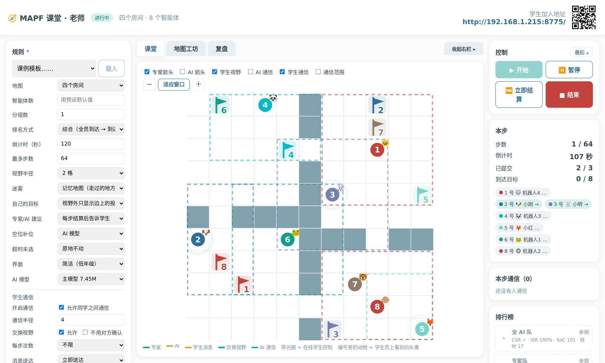
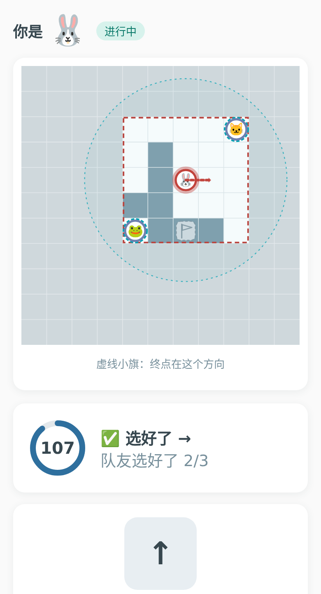
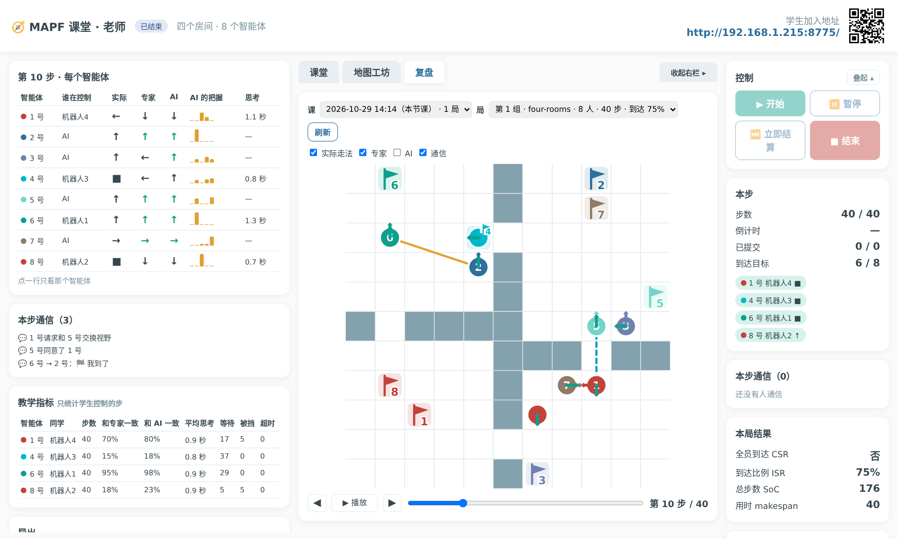
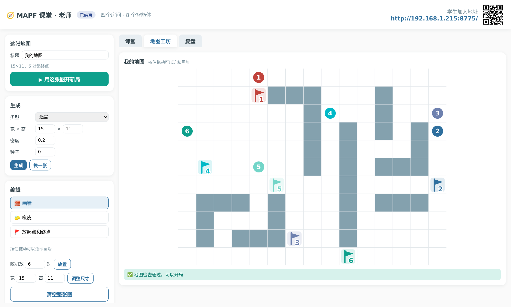
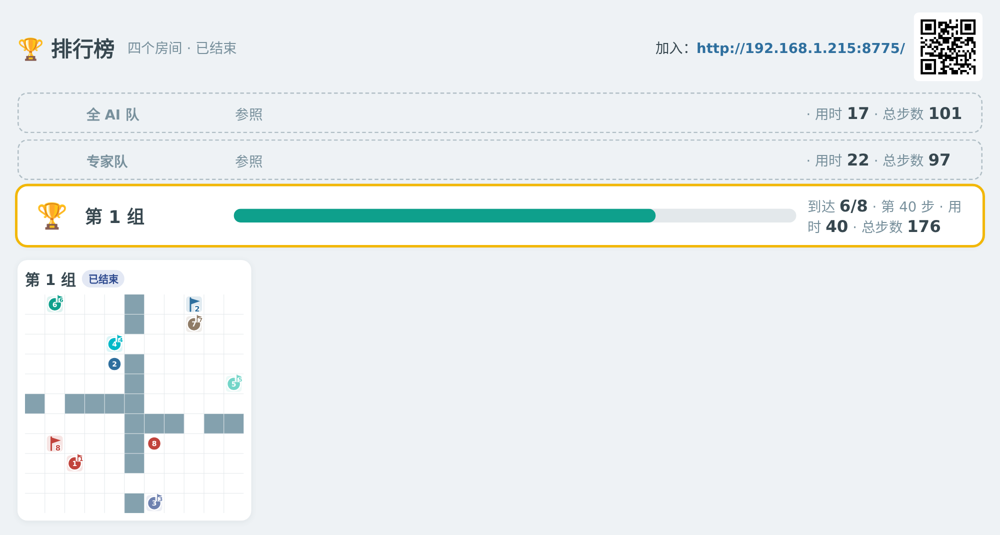
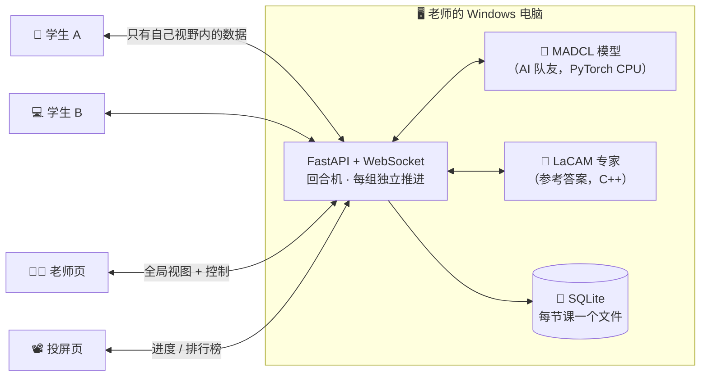
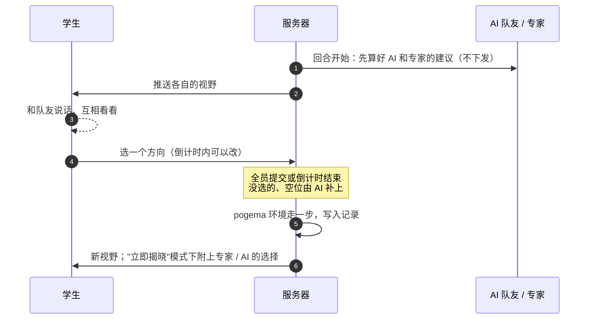

<div align="center">

# 🧭 MAPF 课堂

**把多智能体路径规划搬进教室：每个学生控制一个智能体，和 AI 队友一起把大家都送到终点。**

[](https://github.com/lncosinx/MAPF-Classroom/releases/latest)
[](LICENSE)




<sub>老师页：一局进行中。虚线框是学生的视野，彩色旗子是每个人的终点，圆点旁的小动物和学生页上的头像对应。</sub>

</div>

---

## ✨ 这是什么

**多智能体路径规划**（Multi-Agent Path Finding，MAPF）研究的是：很多机器人在同一张地图上各自去自己的终点，互相不能撞上，怎样让大家都尽快到达。仓库里的物流机器人、游戏里的寻路，背后都是这个问题。

MAPF 课堂把这个问题变成一堂可以玩的课：

- 🙋 **每个学生控制一个智能体**，在只能看到身边几格的"迷雾"里，自己判断往哪走；
- 🤖 **空位由 AI 队友补上**。它是一个会通信的神经网络（MADCL），也只用自己看得到的局部信息；
- 🧠 **专家（LaCAM 规划器）在一旁给出参考答案**，老师可以选择每步结算后告诉学生，或者留到赛后复盘再看；
- 🏆 **分组比拼**，和"全 AI 队""专家队"同台排名，学生能直观看到"人 vs AI vs 最优解"。

只需要一台 Windows 老师机。学生不用装任何东西，手机或电脑的浏览器扫码就能加入，**断网的教室也能用**。

## 📸 看看效果

<table>
<tr>
<td width="32%" align="center" valign="top">
<br>
<b>学生页 · 简洁模式</b><br>
<sub>每人一个动物头像，迷雾里只看得到身边的格子，大按钮、"图标 + 短词"，低年级也能上手</sub>
</td>
<td width="68%" align="center" valign="top">
<br>
<b>复盘</b><br>
<sub>逐步对比"实际 / 专家 / AI"三列，AI 对每个方向的把握，教学指标，一键导出 CSV / SVG 动画</sub>
<br><br>
<br>
<b>地图工坊</b><br>
<sub>一键生成迷宫、房间、仓库地图，画墙、摆起点和终点，自动检查能不能开局</sub>
</td>
</tr>
<tr>
<td colspan="2" align="center">
<br>
<b>投屏页</b><br>
<sub>比赛中只显示进度，各组结束后再揭晓全图；"全 AI 队"和"专家队"作为参照一起排名</sub>
</td>
</tr>
</table>

## 🚀 老师：五分钟开课

1. 到 [**Releases**](https://github.com/lncosinx/MAPF-Classroom/releases/latest) 下载 `MAPF-Classroom-win64-*.zip`（约 170 MB），解压到**不含中文和空格**的文件夹，例如 `D:\MAPF-Classroom`；
2. 双击 **`start_classroom.bat`**，几秒钟后浏览器会自动打开老师页；
3. 第一次运行时 Windows 防火墙会弹窗：勾选 **「专用网络」**，点「允许访问」；
4. 学生连上**同一个 WiFi**，扫老师页右上角的二维码，起个昵称加入；
5. 在「规则」里选地图（也可以直接用课例模板），点 **开始**。

> 💡 学生连不上、端口被占、电脑跑得慢……这些情况在包里的 `README.txt` 都有对应的办法。

## 🧩 功能一览

| | |
|---|---|
| 🌫️ **部分可观测** | 视野半径可调；记忆地图或纯迷雾；终点在视野外时只显示边上的投影 |
| 💬 **学生之间的通信** | 可以"互相看看"（交换视野）或发预设消息；老师可以设通信半径、每步次数、要不要对方同意 |
| 🎚️ **两种界面** | **简洁**（低年级）：动物头像、大按钮、星星评价、彩带；**进阶**（高年级）：步数、AI 动作概率、我的统计 |
| 👀 **老师的上帝视角** | 专家 / AI 箭头、学生视野、学生通信、AI 通信图等叠加层随时开关 |
| 🏁 **分组比拼** | 一键均分成多组同时比赛；按全员到达、到达比例、总步数排名 |
| 🔍 **复盘与导出** | 老师能复盘本节课和以前的课；学生能复盘自己的每一步；导出 CSV（Excel 直接打开）、JSONL、SVG 动画 |
| 🗺️ **地图工坊** | 随机、迷宫、房间、仓库四种生成器；编辑器；地图库；课例模板；AI 能力提示（"AI 在这张图上可能不够聪明"） |
| 🔒 **防作弊、重隐私** | 学生只收到自己视野里的数据（由服务端裁剪）；只存昵称和座位号；课堂记录只留在老师电脑上 |

## 🏗️ 它是怎么工作的



每一步是这样推进的：



- **环境**：[POGEMA](https://github.com/Cognitive-AI-Systems/pogema)，和模型的训练、评测用同一套规则（`on_target=nothing`、软碰撞）；
- **AI 队友**：MADCL，带 FOV 内软稀疏通信的循环网络。主模型 7.45M 参数，另有 2.16M 的轻量版给配置低的电脑；
- **专家**：[LaCAM3](https://github.com/Kei18/lacam3)，每步从当前状态重新求解，只取第一步；
- **前端**：Vue 3（打包在仓库里，没有构建步骤，不引用外网资源）+ 手写 SVG 地图，老师页、学生页、投屏页共用一套绘制代码。

## 🛠️ 开发者

在 Linux 上开发，最终部署在 Windows 上。

```bash
# 环境（Python 3.12，用 uv）
uv venv .venv -p 3.12
uv pip install -p .venv/bin/python torch==2.8.0 --index-url https://download.pytorch.org/whl/cpu
uv pip install -p .venv/bin/python -r requirements.txt
uv pip install -p .venv/bin/python --no-deps third_party/wheels/pogema-2.0.0a0-py3-none-any.whl
cmake -S native/lacam -B build/lacam -DCMAKE_BUILD_TYPE=Release && cmake --build build/lacam -j

# 启动（老师页 http://localhost:8000/teacher）
.venv/bin/python -m classroom.server --port 8000

# 测试（含模型逐层对拍，约 3 分钟）
.venv/bin/python -m pytest -q

# 打 Windows 绿色包（需要 mingw-w64，交叉编译 lacam.dll）
.venv/bin/python packaging/build_windows.py
```

```
classroom/   server/（路由、WebSocket、老师 RPC） core/（回合机、视野、通信、指标） ai/（MADCL、LaCAM 封装）
             maps/（生成器、校验、地图库） storage/（SQLite、复盘、导出）
static/      teacher/ student/ screen/ shared/（地图绘制、主题） vendor/（Vue）
native/      LaCAM 源码        packaging/   Windows 绿色包构建脚本
tests/       单元测试 + 对拍     docs/        各里程碑的验收报告
```

各模块的设计与实测记录见 [`PLAN.md`](PLAN.md) 和 [`docs/`](docs/)，从 [M0](docs/M0_REPORT.md) 一直到 [M7](docs/M7_REPORT.md)；在仓库里干活要知道的细节和易错点见 [`CLAUDE.md`](CLAUDE.md)。

## 🙏 致谢

- [POGEMA](https://github.com/Cognitive-AI-Systems/pogema) 和 pogema-toolbox 的地图生成器（MIT）
- [LaCAM3](https://github.com/Kei18/lacam3)（Keisuke Okumura，MIT），代码取自 [MAPF-GPT](https://github.com/Cognitive-AI-Systems/MAPF-GPT) 的绑定
- [Vue.js](https://vuejs.org/)、[FastAPI](https://fastapi.tiangolo.com/)、[PyTorch](https://pytorch.org/)、[segno](https://github.com/heuer/segno)

## 📄 许可

本项目以 [MIT 许可](LICENSE) 发布。Windows 绿色包里附带的第三方软件，许可证汇总在包内的 `THIRD_PARTY_LICENSES.txt`。
